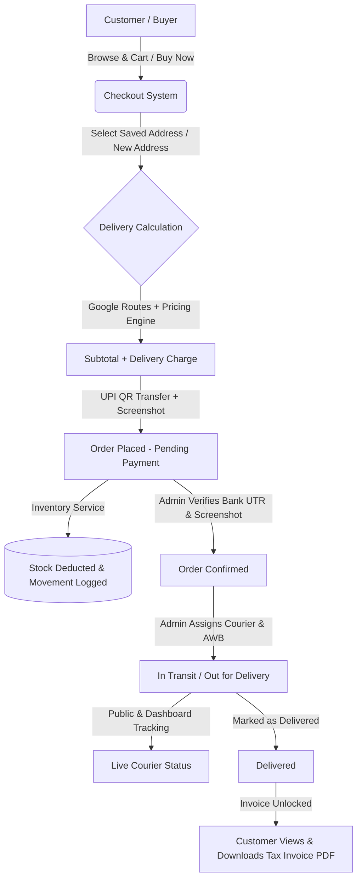
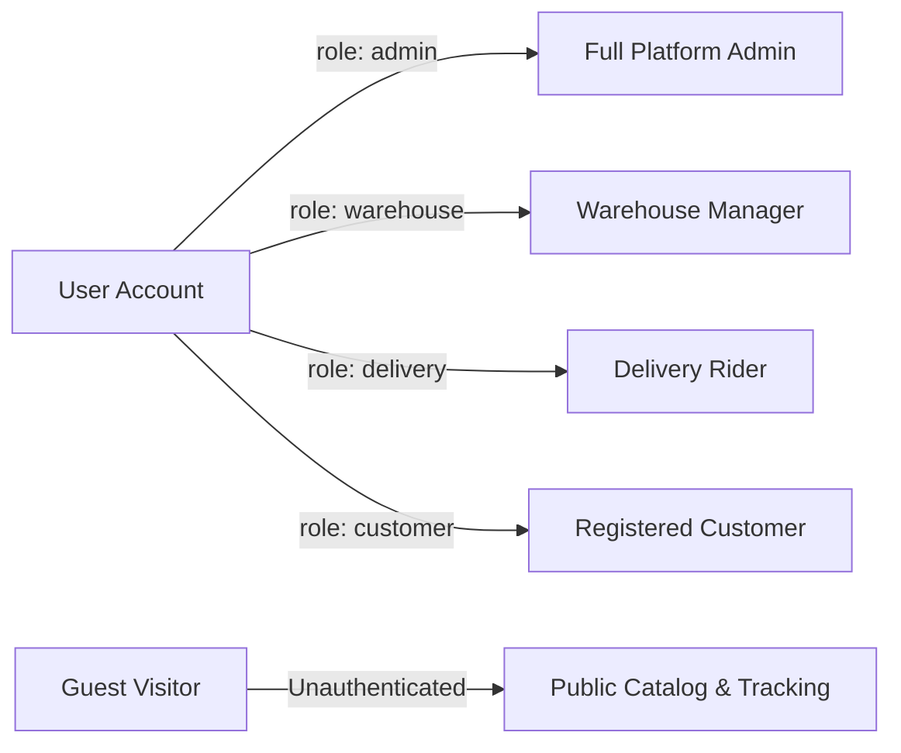
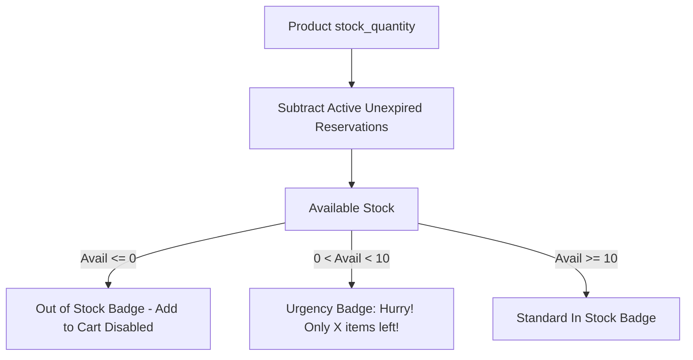
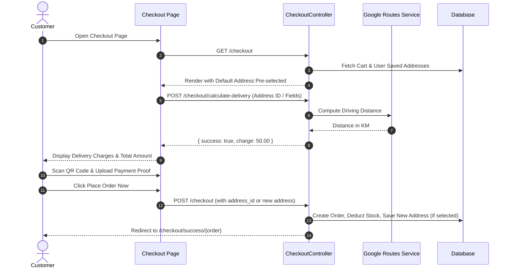
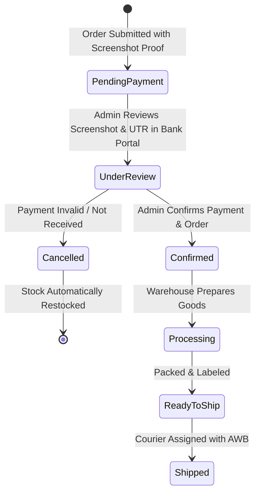
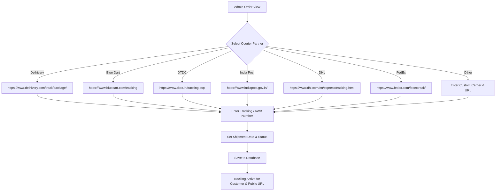
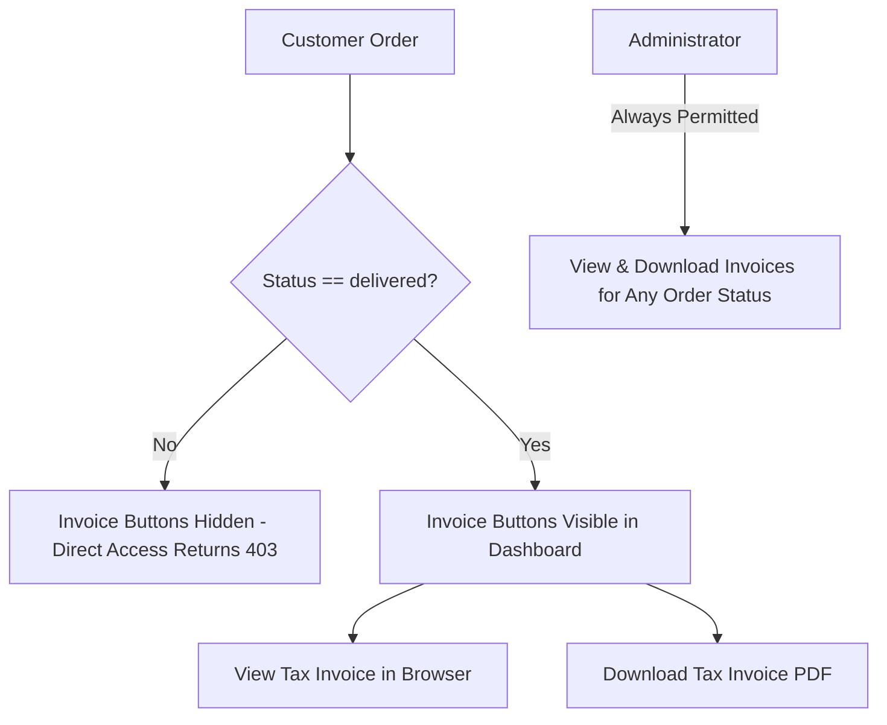
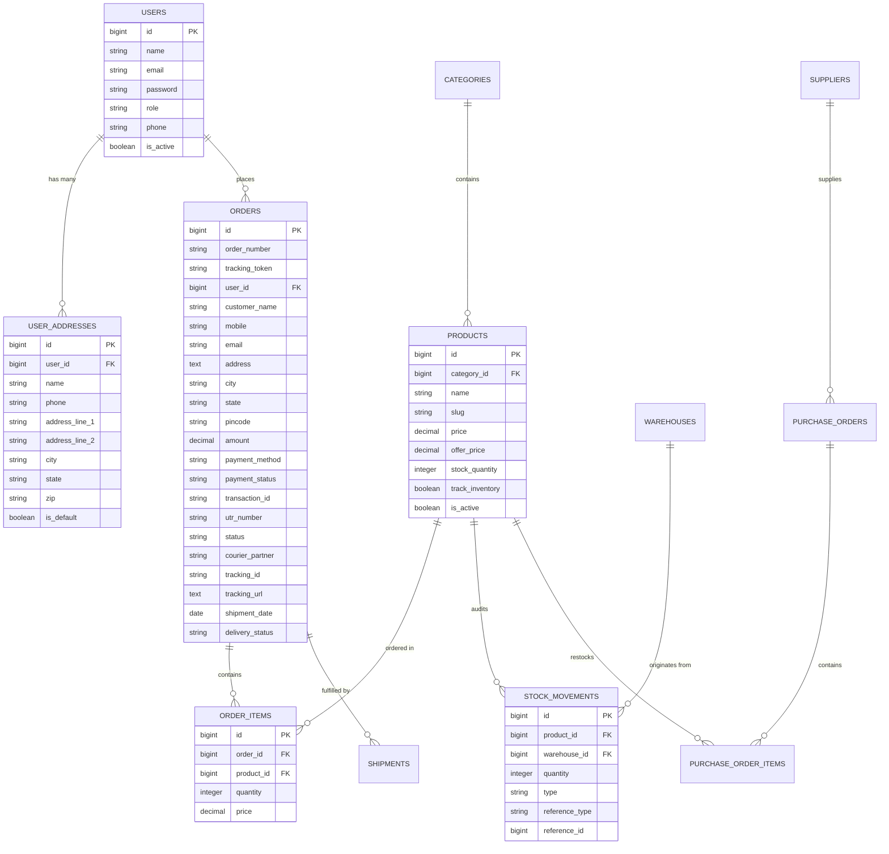

# TC Smart Technology — Complete E-Commerce Platform Documentation
**Comprehensive End-to-End System, Product, Order, Payment, Inventory, Courier Tracking & Invoicing Manual**

---

## 1. Executive Overview & Technology Stack

### 1.1 Overview
**TC Smart Technology** is a modern e-commerce and industrial IoT platform specializing in embedded systems, smart sensing devices, industrial automation modules, and monitoring hardware.

The platform provides a comprehensive commerce experience featuring:
- Real-time inventory tracking with dynamically calculated urgency badges.
- Dual-channel checkout (Direct Buy Now + Shopping Cart).
- Customer saved addresses with one-click selection and auto-fill.
- Dynamic road distance delivery pricing powered by Google Maps Routes API.
- Direct UPI / QR Code payments with manual verification and proof uploads.
- Manual courier shipment assignment and tracking (supporting Delhivery, Blue Dart, DTDC, India Post, DHL, FedEx, and custom carriers).
- Self-service parcel tracking for customers via public tokens and order numbers.
- Automated tax invoicing with PDF downloads restricted to delivered orders.
- Warehouse, supplier, and purchase order goods receipt workflows.



### 1.2 Technology Stack
| Layer | Technologies & Libraries |
| :--- | :--- |
| **Backend Framework** | Laravel 11.x (PHP 8.2+) |
| **Architecture** | MVC (Model-View-Controller) + Dedicated Service Layer |
| **Database** | MySQL 8.0+ (Production) / SQLite in-memory (Automated Testing) |
| **Frontend UI** | Blade Templates, Vanilla CSS, Bootstrap 5.3, FontAwesome 5/6, OwlCarousel |
| **Alerts & Modals** | SweetAlert2, Bootstrap Native Modals & Offcanvas |
| **Distance & Routing** | Google Maps Routes API v2 (`https://routes.googleapis.com/directions/v2:computeRoutes`) |
| **PDF Generation** | DomPDF (`barryvdh/laravel-dompdf`) |
| **File Storage** | Laravel Public Storage Disk (`storage/app/public/`) |
| **Testing Suite** | PHPUnit 11 & Pest Testing Framework (35 Passing Tests, 155 Assertions) |

---

## 2. Role-Based Access Control & User Roles

The platform provides role-based authorization managed via `App\Models\User` and route middleware `role:<role_name>`.



### 2.1 Role Breakdown

| Role | Access URL Scope | Key Capabilities |
| :--- | :--- | :--- |
| **Admin** (`admin`) | `/admin/*` | Full catalog management, order approvals, payment verification, courier assignment, manual tracking updates, invoice settings, QR code management, warehouse configuration, delivery agent tracking. |
| **Warehouse** (`warehouse`) | `/admin/inventory`, `/admin/purchase_orders` | Stock audits, purchase order goods receipt, stock reservations, warehouse hub management. |
| **Delivery** (`delivery`) | `/admin/delivery_personnel` | Availability toggles, assigned parcel status logs, delivery attempt history. |
| **Customer** (`customer`) | `/dashboard/*`, `/checkout/*` | Catalog browsing, wishlist, cart management, saved addresses, order tracking, invoice viewing/downloading when delivered. |
| **Guest** | `/`, `/products/*`, `/track` | Public browsing, direct buy now, guest checkout, public order tracking by token or order number. |

---

## 3. Product Catalog, Inventory Control & Urgency Badges

### 3.1 Product Model & Stock Engine
Products are represented by `App\Models\Product` and categorized under `App\Models\Category`.



#### Dynamic Available Stock Calculation
```php
public function availableStock(): int
{
    if (!$this->track_inventory) {
        return 999999;
    }

    $activeReservations = $this->stockReservations()
        ->where('status', 'reserved')
        ->where('expires_at', '>', now())
        ->sum('quantity');

    return max(0, (int)$this->stock_quantity - (int)$activeReservations);
}
```

### 3.2 Visual Urgency Badges on Product Details (`/product/{slug}`)
- **Out of Stock** (`availableStock() <= 0`):
  - Red badge: `Out of Stock`
  - Purchase buttons ("Add to Cart" and "Buy Now") are disabled.
- **Urgency Alert** (`availableStock() < 10`):
  - Orange warning badge: `Hurry! Only X items left in stock!`
  - Highlights scarcity to drive purchase conversions.
- **In Stock** (`availableStock() >= 10`):
  - Clean green badge: `In Stock`.

### 3.3 Inventory Movement Audit Trail (`stock_movements`)
Every modification to inventory records an immutable log:
- `order_sale`: Stock deducted when customer completes order.
- `order_cancelled`: Stock automatically restocked when order is cancelled.
- `po_receipt`: Stock incremented when purchase order items are received.
- `adjustment`: Manual admin stock adjustment.

---

## 4. Customer Shopping, Wishlist & Cart Workflows

### 4.1 Shopping Cart & Mini-Cart Drawer
- **Persistent Cart**: Managed via `App\Services\CartService` using session-based storage.
- **Drawer Offcanvas**: Instant sliding side-cart accessible on any page (`#offcanvasCart`) without requiring page reloads.
- **Item Adjustments**: Real-time quantity increment/decrement, line-item totals, and remove item AJAX endpoints.

### 4.2 Wishlist
- Toggle products into customer wishlist via AJAX.
- Live badge count in header.
- View and manage wishlist items in customer account dashboard.

---

## 5. Checkout System, Saved Addresses & Delivery Pricing Engine

The checkout page at **`http://127.0.0.1:8000/checkout`** (and `/checkout/{product_id}`) provides a streamlined 3-step checkout flow.



### 5.1 Selectable Saved Addresses Grid (`user_addresses`)
When an authenticated customer visits checkout:
1. **Saved Address Cards**: All addresses linked to the customer are rendered as selectable cards.
2. **Default Selection**: The customer's default address (`is_default = true`) is automatically selected on page load.
3. **One-Click Auto-Fill**: Clicking any address card automatically updates the form fields (`customer_name`, `mobile`, `address`, `city`, `state`, `pincode`).
4. **Different / New Address**:
   - Selecting `+ Deliver to a Different Address` clears the fields for custom entry.
   - Reveals an optional checkbox: `[x] Save this address to my account for future orders`.
5. **Adaptive Typing Sync**: If the user edits any address input while a saved address card was active, the UI automatically transitions to custom address mode.
6. **Guest Users**: Display an informative notification: *"Already have saved addresses? Sign in to auto-fill your delivery details."* with a direct login link preserving the return redirect.

### 5.2 Distance-Based Delivery Pricing Engine
- **Service Integration**: `GoogleRoutesService` connects to Google Maps Routes API v2 to calculate driving distance between the origin warehouse and destination address.
- **30-Day Response Cache**: Route distances are cached in Laravel Cache for 30 days based on MD5 hashes of origin and destination strings, minimizing external API calls.
- **Configurable Pricing Rules** (`DeliveryPricingService`):
  - `delivery_charge_enabled`: Master switch for delivery calculation.
  - `delivery_distance_enabled`: Toggle between flat base fee vs. per-km distance fee.
  - `delivery_base_fee`: Minimum starting charge (default ₹30.00).
  - `delivery_per_km_fee`: Additional charge per kilometer (default ₹8.00/km).
  - `delivery_min_fee` & `delivery_max_fee`: Hard safety boundaries.
  - `free_delivery_enabled` & `free_delivery_min_order`: Waives delivery charge for orders meeting minimum subtotal (e.g., ₹1,000+).
  - `delivery_max_distance`: Maximum radius cutoff (e.g., 100 km).
- **Clean Checkout Display**: The checkout order summary displays the exact delivery fee (e.g. `₹50.00` or `Free`), keeping internal kilometer numbers hidden from customer view.

---

## 6. UPI / QR Code Payment Verification Workflow

The platform operates an authorized manual UPI payment gateway. Aggregator fees and gateway commissions are completely avoided.



### 6.1 Payment Process
1. **Dynamic Dynamic QR Code**: Admin uploads UPI payment QR code via **Admin Settings > Payment QR**.
2. **Exact Payment Display**: Customer is shown the QR code with the exact calculated Grand Total (Product Subtotal + Delivery Charges).
3. **Submission of Proof**:
   - Customer scans QR code in Google Pay, PhonePe, Paytm, or BHIM.
   - Customer enters **Transaction ID** (e.g., `T2610231948...`).
   - Customer enters **UTR Number** (12-digit bank reference number).
   - Customer selects **Payment Date**.
   - Customer uploads **Payment Screenshot** (`.jpg`, `.jpeg`, `.png`, max 5 MB).
   - Customer confirms mandatory acknowledgement checkbox.
4. **Immediate Stock Commitment**:
   - Inventory is immediately reserved/deducted upon order creation via `InventoryService::commitOrderSale($order)` to prevent stock collisions.

---

## 7. Admin Order Management & Manual Courier Tracking (Without Shiprocket)

Administrators have full control over shipment processing without third-party aggregator dependencies.



### 7.1 Courier Partner Directory & Official URL Mapping
The following courier partners are natively supported with automatic URL prefilling:

| Courier Partner | Official Carrier Code | Default Tracking Website URL |
| :--- | :--- | :--- |
| **Delhivery** | `delhivery` | `https://www.delhivery.com/track/package/` |
| **Blue Dart** | `bluedart` | `https://www.bluedart.com/tracking` |
| **DTDC** | `dtdc` | `https://www.dtdc.in/tracking.asp` |
| **India Post** | `indiapost` | `https://www.indiapost.gov.in/` |
| **DHL Express** | `dhl` | `https://www.dhl.com/en/express/tracking.html` |
| **FedEx** | `fedex` | `https://www.fedex.com/fedextrack/` |
| **Other Courier** | `other` | Custom administrator URL input |

### 7.2 Database Schema: Orders Courier Columns
Added via database migration `2026_10_10_053343_add_delivery_details_to_orders_table.php`:
- `courier_partner` (`string|nullable`): Carrier name or identifier.
- `tracking_id` (`string|nullable`): AWB / Consignment tracking number.
- `tracking_url` (`text|nullable`): Carrier website tracking URL.
- `shipment_date` (`date|nullable`): Date parcel handed over to courier.
- `delivery_status` (`string|nullable`): Dedicated shipment status.
- `delivery_notes` (`text|nullable`): Internal or customer dispatch remarks.
- `tracking_token` (`string(32)`): Unique public access token.

### 7.3 Delivery Status Progression
1. **Processing**: Order approved; items picked in warehouse.
2. **Ready to Ship**: Items packed, invoice generated, box labeled.
3. **Shipped**: Handed over to courier; AWB entered by administrator.
4. **In Transit**: Parcel in carrier transit between hub and destination city.
5. **Out for Delivery**: Local courier delivery executive dispatched for final delivery.
6. **Delivered**: Parcel received by customer.
7. **Delivery Failed**: Delivery attempted but unsuccessful (address unreachable, customer unavailable).

### 7.4 Dedicated Quick-Action Endpoints
- **Update Shipment**: `POST /admin/orders/{order}/manage-shipment`
- **Mark as Delivered**: `POST /admin/orders/{order}/mark-delivered`
- **General Status Update**: `PUT /admin/orders/{order}`

---

## 8. Public & Customer Self-Service Tracking

The platform offers 3 tracking channels for customers:

### 8.1 Tracking Access Paths
1. **Public Tracking Search** (`/track`):
   - Any visitor can enter their **Order Number** (e.g., `ORD-670783F41B`) or **AWB Tracking ID**.
   - Displays real-time delivery status, courier partner, dispatch date, and direct carrier tracking link.
2. **Tokenized Direct Link** (`/track/{tracking_token}`):
   - Instant access via unique, unguessable token embedded in customer emails.
   - No login or order number entry required.
3. **Customer Dashboard** (`/dashboard/orders/{id}`):
   - Dedicated authenticated order view with progress timeline, courier badge, AWB copy tool, and live *"Track Courier Shipment"* external link button.

```mermaid
flowchart LR
    Email[Order Dispatch Email] -->|One-click Token Link| TrackURL[/track/token123]
    Portal[Customer Dashboard] -->|View Order #9| OrderDetail[/dashboard/orders/9]
    PublicPage[Tracking Page] -->|Search Order or AWB| PublicSearch[/track]
    TrackURL & OrderDetail & PublicSearch --> TrackingView[Live Tracking Interface]
    TrackingView --> ExternalCarrier[Official Courier Tracking Portal]
```

---

## 9. Tax Invoicing System & PDF Generation

The platform includes an automated GST-compliant Tax Invoicing engine.



### 9.1 Viewing Restriction Rule
- **Customers**: Can only view or download an invoice **after** the order status is marked as `delivered`. If an un-delivered order's invoice URL is accessed directly, an HTTP 403 Forbidden is returned with the message: *"Invoice will be available once the order is delivered."*
- **Administrators**: Can view, print, or download invoices at **any time** across all order statuses.

### 9.2 Invoice Settings (`/admin/settings`)
Administrators configure business legal details via `Admin SettingController::updateInvoiceSettings`:
- `company_name`: Legal entity name (e.g., `TC Smart Technology Pvt. Ltd.`)
- `company_gstin`: 15-character GST identification number.
- `company_pan`: Permanent Account Number.
- `company_phone` & `company_email`: Official customer support contact.
- `company_address`: Registered office address.
- `invoice_prefix`: Invoice numbering prefix (e.g., `INV-2026-`).
- `invoice_terms`: Payment terms and legal dispute jurisdiction notes.

### 9.3 Itemized Breakdown & PDF Architecture
- Rendered using `resources/views/invoices/tax_invoice.blade.php` and `resources/views/invoices/tax_invoice_pdf.blade.php`.
- Features Seller Details, Buyer Billed-to & Shipped-to Details, Order ID, Date, Item breakdown (Unit Price, Quantity, Line Total), Delivery Charges, Taxes, Grand Total, and Bank Transaction / UTR reference.
- Compiled to PDF using `Barryvdh\DomPDF\Facade\Pdf`.

---

## 10. Warehouse, Supplier & Purchase Order Lifecycle

### 10.1 Warehouses (`warehouses`)
- Multi-warehouse capability with designated primary dispatch hub (`is_default`).
- Tracks warehouse code, contact, street address, city, state, and pincode used for Google Routes delivery origin calculations.

### 10.2 Purchase Orders & Goods Receipt (`purchase_orders`)
- **PO Creation**: Purchase orders issued to suppliers for inventory restocking.
- **Goods Receipt** (`POST /admin/purchase_orders/{id}/receive`):
  - Automatically updates product stock quantity (`stock_quantity += received_quantity`).
  - Records an immutable `stock_movements` log with type `po_receipt`.
  - Marks purchase order status as `received`.

---

## 11. Complete Database Schema (ERD)



---

## 12. Complete Routes & API Directory

### 12.1 Public & Customer Routes
| Method | URI | Action / Controller | Purpose |
| :--- | :--- | :--- | :--- |
| `GET` | `/` | `Frontend\HomeController::index` | Homepage with banners and featured products |
| `GET` | `/products` | `Frontend\ProductController::index` | Product catalog with filters |
| `GET` | `/product/{slug}` | `Frontend\ProductController::show` | Product details with stock badges |
| `POST` | `/cart/add` | `CartController::add` | Add product to cart |
| `GET` | `/cart` | `CartController::index` | Cart management page |
| `GET` | `/checkout` | `CheckoutController::index` | Cart checkout page |
| `GET` | `/checkout/{product}` | `CheckoutController::index` | Direct Buy Now checkout |
| `POST` | `/checkout/{product?}` | `CheckoutController::store` | Place order and upload payment proof |
| `POST` | `/checkout/calculate-delivery` | `CheckoutController::calculateDelivery`| Compute distance delivery charges |
| `GET` | `/checkout/success/{order}` | `CheckoutController::success` | Order confirmation success screen |
| `GET` | `/track/{token?}` | `TrackingController::show` | Public order and parcel tracking |
| `POST` | `/track` | `TrackingController::show` | Tracking search by order/AWB |
| `GET` | `/dashboard` | `Frontend\DashboardController::index` | Customer account dashboard |
| `GET` | `/dashboard/orders/{id}` | `Frontend\DashboardController::order` | Customer order details |
| `GET` | `/dashboard/orders/{id}/invoice` | `Frontend\InvoiceController::show` | View tax invoice (Delivered only) |
| `GET` | `/dashboard/orders/{id}/invoice/pdf` | `Frontend\InvoiceController::downloadPdf` | Download invoice PDF (Delivered only) |

### 12.2 Admin Management Routes (`/admin/*`)
| Method | URI | Controller Action | Purpose |
| :--- | :--- | :--- | :--- |
| `GET` | `/admin/orders` | `Admin\OrderController::index` | Manage and filter orders |
| `GET` | `/admin/orders/{order}` | `Admin\OrderController::show` | Order details and shipment manager |
| `POST` | `/admin/orders/{order}/manage-shipment` | `Admin\OrderController::updateShipment` | Assign courier, AWB, URL, status |
| `POST` | `/admin/orders/{order}/mark-delivered` | `Admin\OrderController::markDelivered` | Dedicated quick action: Mark Delivered |
| `GET` | `/admin/orders/{order}/invoice` | `Admin\InvoiceController::show` | View tax invoice (All statuses) |
| `GET` | `/admin/orders/{order}/invoice/pdf` | `Admin\InvoiceController::downloadPdf` | Download invoice PDF (All statuses) |
| `GET` | `/admin/settings` | `Admin\SettingController::index` | Settings overview |
| `POST` | `/admin/settings/qr-code` | `Admin\SettingController::updateQrCode` | Upload/update UPI payment QR code |
| `POST` | `/admin/settings/invoice` | `Admin\SettingController::updateInvoiceSettings` | Configure GST, PAN, address, terms |
| `POST` | `/admin/settings/delivery-charge` | `Admin\SettingController::updateDeliveryCharge`| Configure base and per-km pricing |
| `GET` | `/admin/inventory` | `Admin\InventoryController::index` | Stock levels and audits |
| `POST` | `/admin/purchase_orders/{po}/receive` | `Admin\PurchaseOrderController::receive` | Receive goods and auto-restock |

---

## 13. System Maintenance & Verification

### 13.1 Running the Automated Test Suite
The codebase includes 35 automated tests covering all critical paths:
```bash
php artisan test
```

Expected output:
```bash
PASS  Tests\Unit\ExampleTest
PASS  Tests\Feature\CheckoutSavedAddressTest
PASS  Tests\Feature\ExampleTest
PASS  Tests\Feature\InventoryAndDeliveryManagementTest
PASS  Tests\Feature\InvoiceManagementTest
PASS  Tests\Feature\ManualCourierDeliveryTrackingTest
PASS  Tests\Feature\ProductStockDisplayTest

Tests: 35 passed (155 assertions)
Duration: ~1.8 seconds
```

### 13.2 Key Production Configuration Checklist
- **Database Connection**: Set `DB_CONNECTION`, `DB_HOST`, `DB_DATABASE`, `DB_USERNAME`, `DB_PASSWORD` in `.env`.
- **Public Storage Symlink**: Ensure `php artisan storage:link` has been executed for QR codes and payment screenshot access.
- **Google Maps Routes API Key**: Set `services.google.routes_api_key` or `GOOGLE_MAPS_ROUTES_API_KEY` for driving distance calculations.
- **Admin Email Notifications**: Set `ADMIN_EMAIL` in `.env` for order placement alerts.

---

*Documentation Version 1.0 — Generated for TC Smart Technology E-Commerce Platform Handover.*
